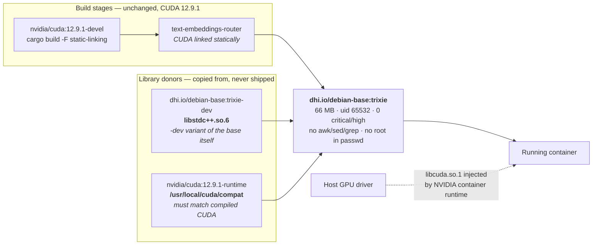

This guide shows how to move a GPU inference container onto a Docker Hardened
Image (DHI) base. The worked example is
[Text Embeddings Inference](https://github.com/huggingface/text-embeddings-inference)
(TEI), a Rust embedding server that compiles CUDA kernels, but nothing here is
specific to TEI. The same sequence applies to any container that talks to an
NVIDIA GPU.

By the end you'll have an image that runs as a non-root user, carries no shell
entrypoint, ships a fraction of the packages, and still runs CUDA kernels on the
GPU.

## Why GPU images don't follow the standard migration path

The [language migration examples](/manuals/dhi/migration/examples/_index.md) all follow one
pattern: swap the base image for a `-dev` tag in the build stage and a runtime tag
in the final stage, and you're done. GPU images break that paradigm in three places.

- The CUDA version is a constraint, not a preference: `dhi.io/nvidia-cuda`
  publishes CUDA 13.x. If your application pins a CUDA-12-era toolchain, you
  cannot move the build stage onto it.
- One library is deliberately missing from every image: `libcuda.so.1` is
  the GPU driver library. It belongs to the host, is injected into the container
  at run time by the NVIDIA container runtime, and must never be baked into an
  image. Every link check you run will show it missing, and that is correct.
- The usual smoke test doesn't exist: you cannot run the image on your laptop
  or on a standard CI runner, because neither has a GPU. You need a check that
  distinguishes "no GPU here" from "this image is missing a library."

Work through those three and the rest is an ordinary DHI migration.

What you're aiming for:



## Step 1: Find what your binary actually needs

Do this before you look at the catalog. The dependency closure of your compiled
binary is the specification that a base image has to satisfy. Everything else is
guessing.

Extract the binary from your current image and inspect it:

```console
$ cid=$(docker create your-image:current /noop)
$ docker cp "$cid":/usr/local/bin/your-binary ./your-binary
$ docker rm "$cid"
$ docker run --rm -v "$PWD/your-binary:/t:ro" debian:trixie-slim ldd /t
```

The `/noop` is a placeholder command. `docker create` refuses an image with no
`CMD` and no command argument, which several minimal images are; the container
is never started, so the value is irrelevant.

For TEI, that returns:

```text
libstdc++.so.6 => /lib/x86_64-linux-gnu/libstdc++.so.6
libcuda.so.1 => not found
libssl.so.3 => /lib/x86_64-linux-gnu/libssl.so.3
libcrypto.so.3 => /lib/x86_64-linux-gnu/libcrypto.so.3
libgcc_s.so.1 => /lib/x86_64-linux-gnu/libgcc_s.so.1
libm.so.6 => /lib/x86_64-linux-gnu/libm.so.6
libc.so.6 => /lib/x86_64-linux-gnu/libc.so.6
libz.so.1 => /lib/x86_64-linux-gnu/libz.so.1
libzstd.so.1 => /lib/x86_64-linux-gnu/libzstd.so.1
```

That list informs the whole migration:

- `libcudart` and `libcublas` are absent: TEI links CUDA statically. The
  runtime image therefore never loads a CUDA runtime library, which means the
  base image does not have to match the CUDA version the binary was compiled
  against. If your binary links CUDA dynamically, those entries appear here and
  your base image must supply them.
- `libcuda.so.1` is "not found" and stays that way: that's the driver.
- Everything else is ordinary: glibc, libstdc++, OpenSSL, zlib, zstd. Any
  general-purpose base can supply those.

> [!TIP]
>
> If your application links CUDA statically, you have far more freedom in
> choosing a base than the CUDA version suggests. Check before you assume you're
> locked to a CUDA base image.

> [!IMPORTANT]
>
> A satisfied link closure proves the image is packaged correctly. It does not
> prove the image will run on your target. The host's driver has to support your
> CUDA version (Step 4), and the platform has to hand you a host that does
> (Step 8).

## Step 2: Choose a base from the closure, not from the name

Browse the catalog with the DHI CLI rather than guessing repository names:

```console
$ docker dhi catalog list
$ docker dhi catalog get nvidia-cuda
$ docker dhi catalog get debian-base
```

Three candidates matter for a GPU workload. Measured on `linux/amd64`:

| Base | Size | Shell | `libstdc++` | OpenSSL | zlib/zstd |
|------|------|-------|-------------|---------|-----------|
| `dhi.io/static:20250419-glibc` | 22.1 MB | no | no | no | no |
| `dhi.io/debian-base:trixie` | 66.4 MB | `bash`, `sh` | no | yes | yes |
| `dhi.io/nvidia-cuda:13.2` | 3.02 GB | no | yes | yes | yes |

The instinct is to reach for `nvidia-cuda`. Resist it when your binary links CUDA
statically: you would ship 3 GB of CUDA runtime libraries the process never
loads, and inherit a constraint you don't want (see the warning below).

`debian-base` satisfies every entry in the closure except `libstdc++`, at 66 MB.
That is the base to build on.

> [!WARNING]
>
> `dhi.io/nvidia-cuda:13.2` sets `NVIDIA_REQUIRE_CUDA=cuda>=13.2` in its
> environment. The NVIDIA container runtime enforces that at container start, so
> the image refuses to run on a host whose driver only supports CUDA 12,
> regardless of what your binary needs. That includes hosts that are current
> by most standards: SageMaker's `gpu-4-1` GPU inference AMI,
> `al2023-ami-sagemaker-inference-gpu-4-1`, ships a driver that supports CUDA
> 13.0. If your fleet runs older drivers, that environment variable, not your
> code, is what stops the container.

## Step 3: Supply the missing library from a sibling DHI image

`debian-base` is missing exactly one library. The tempting fix is to copy
`libstdc++.so.6` out of your build stage. Don't do it; your build stage is an ordinary
distribution image, and copying its copy of a library into a hardened image silently
opts that file out of the patch stream you're adopting DHI for in the first place.

Copy it from another DHI image on the same distribution instead. The `-dev`
variant of the runtime base itself ships `libstdc++` and is the closest source
you can get, with the same image family, distribution and ABI:

```dockerfile
FROM dhi.io/debian-base:trixie-dev AS dhi-libs

FROM dhi.io/debian-base:trixie
COPY --from=dhi-libs /usr/lib/x86_64-linux-gnu/libstdc++.so.6.0.33 \
                     /usr/lib/x86_64-linux-gnu/libstdc++.so.6
```

`dhi.io/nvidia-cuda:13.2` also carries a matching `libstdc++`, but it's 3 GB
against `trixie-dev`'s 117 MB. Either works; prefer the smaller donor. Neither
donor stage reaches the final image; only the copied file does.

> [!NOTE]
>
> Check the distribution before copying between DHI images. `docker dhi catalog
> get <image>` reports it under **Distributions**. Copying a library from an
> Alpine-based DHI into a Debian-based one will not work.
>
> Check the `-dev` variant of your runtime base first. It's the smallest donor
> that is guaranteed to match.
>
> With a DHI Select or Enterprise subscription you can
> [add the package to the image itself](/manuals/dhi/how-to/customize.md)
> instead, which keeps the rebuild automatic.

## Step 4: Decide the CUDA compatibility shim at build time

CUDA's forward-compatibility shim (`/usr/local/cuda/compat`) lets a binary built
against a newer CUDA run on a host whose driver comes from an older, supported
branch. There is no DHI source
for it: DHI's CUDA images start at 13.x, and the shim has to match the version
your binary was *compiled* against. It comes from the NVIDIA image:

```dockerfile
FROM nvidia/cuda:12.9.1-runtime-ubuntu24.04 AS cuda-compat-source
```

Start by measuring the host driver, on a host provisioned the way
production provisions them. Managed platforms often
choose the host image for you, and the default is not always current (see
[Step 8](#if-you-deploy-to-amazon-sagemaker)). Run `nvidia-smi` there and read
both numbers:

```text
| NVIDIA-SMI 470.256.02   Driver Version: 470.256.02   CUDA Version: 11.4 |
```

Newer drivers print the same two numbers under new labels, `KMD Version` and
`CUDA UMD Version`. Anything that parses this header has to match both forms.

That tells you which of three cases you're in:

| Host driver supports | Your binary needs | What to do |
|---|---|---|
| Same or newer CUDA | — | No shim. Loading one against a newer driver breaks CUDA init; `cuda-compat-12-9` is unsupported on R580 and later. |
| An older CUDA, same major version | For example, 12.4 host, 12.9 binary | Usually no shim. CUDA's minor version compatibility runs a 12.x binary on any 12.x driver, provided it doesn't need PTX JIT or newer driver APIs. TEI precompiles its kernels for the target GPU, so it qualifies. |
| An older *major* version | For example, 11.4 host, 12.9 binary | The shim is the only image-side option, and only if the host's driver branch appears in NVIDIA's [forward-compatibility matrix](https://docs.nvidia.com/deploy/cuda-compatibility/forward-compatibility.html). For `cuda-compat-12-9` that means R535 or R570, both CUDA 12 already, so in practice it can't bridge a major version. Rebuild against a CUDA the driver supports, or deploy somewhere newer. |

The third row happens in practice. This is what it looks like.
A driver from the R470 branch reports CUDA 11.4 and is end-of-life;
`cuda-compat-12-9` ships `libcuda.so.575.57.08` and supports only the R535 and
R570 branches. The shim loads exactly as intended and cannot help:

```text
Could not find a compatible CUDA device on host: CUDA is not available
Caused by: DriverError(CUDA_ERROR_SYSTEM_DRIVER_MISMATCH, ...)
WARN  Using CPU instead
Starting <model> on Cpu
memory allocation of 34359738368 bytes failed
```

The driver error is caught, the framework falls back to
CPU, and the process dies allocating the model in host RAM. The surfaced error
is an out-of-memory failure two layers downstream of the real cause, and nothing
in it names a driver. Forward compatibility has a supported range; outside it
there is no image-side fix.

Once you know which case applies, make it a build argument rather than a runtime
probe. The host driver is a property of the deployment target, known at build
time:

```dockerfile
ARG CUDA_COMPAT_LD_PATH=
ENV LD_LIBRARY_PATH=${CUDA_COMPAT_LD_PATH}/usr/local/nvidia/lib:/usr/local/nvidia/lib64
COPY --from=cuda-compat-source /usr/local/cuda/compat /usr/local/cuda/compat
```

Build with the default for a host in the first two rows, and with the shim only
for an older branch that the matrix supports:

```console
$ docker build --build-arg CUDA_COMPAT_LD_PATH=/usr/local/cuda/compat: .
$ docker run --rm --entrypoint /usr/bin/printenv your-image:dhi LD_LIBRARY_PATH
/usr/local/cuda/compat:/usr/local/nvidia/lib:/usr/local/nvidia/lib64
```

> [!NOTE]
>
> Know why each `LD_LIBRARY_PATH` entry is there. `/usr/local/nvidia/lib64` is
> where some platforms, GKE among them, mount the host driver without refreshing
> the linker cache. Upstream TEI's entrypoint runs `ldconfig` for that directory,
> and `debian-base` has no `ldconfig`, so listing it here is what lets the
> loader find `libcuda.so.1` there. On Amazon SageMaker the runtime injects the
> driver into `/usr/lib/x86_64-linux-gnu/` instead, and the entry does nothing.
> Entries that don't exist are silently ignored, so a missing one costs you
> nothing until the day you depend on it.

## Step 5: Adapt to the non-root default

DHI images run as uid 65532. Two defaults that work under `root` stop working.

Ports below 1024: a non-root process cannot bind them without
`CAP_NET_BIND_SERVICE`. TEI defaults to port 80; move it:

```dockerfile
ENV PORT=8080
EXPOSE 8080
```

Writable directories: anything the process writes to, such as a model cache
or a scratch directory, has to be owned by 65532:

```dockerfile
USER 0:0
RUN mkdir -p /data && chown 65532:65532 /data
USER 65532:65532
```

> [!IMPORTANT]
>
> Use `USER 0:0`, not `USER root`. `debian-base` ships an `/etc/passwd`
> containing only `nonroot` and `nobody`. There is no `root` entry to resolve,
> and the build fails with `unable to find user root: no matching entries in
> passwd file`. Not every DHI image strips it, so don't rely on either behavior:
> address the superuser numerically.

On a base with no shell at all, `RUN` isn't available either. Create the
directory with the right ownership at copy time instead:

```dockerfile
COPY --chown=65532:65532 empty-dir/ /data/
```

## Step 6: Replace the shell entrypoint

Runtime DHI images are minimal in ways that go beyond "no package manager," and
a shell script entrypoint is usually the first casualty:

- `dhi.io/nvidia-cuda:13.2` has no shell at all.
- `dhi.io/debian-base:trixie` has `bash` and the full coreutils set, but no
  `awk`, no `sed`, no `grep`, and no `ldconfig`.

TEI's own entrypoint pipes `nvidia-smi` through `grep` and runs `ldconfig`, so
it fails on both, for different reasons. Once the compatibility decision has moved to build time
(Step 4), the script has nothing left to decide, and the binary can be the
entrypoint:

```dockerfile
ENTRYPOINT ["/usr/local/bin/text-embeddings-router"]
ENV JSON_OUTPUT=true
```

Set flags the binary must always get as environment variables, not in `CMD`.
Some platforms replace `CMD` (Step 8), and TEI reads every flag from the
environment.

There is one job the old entrypoint may still be doing that you can't see from
inside the image: absorbing arguments the *platform* appends to the container
command. If you deploy somewhere that does this (Amazon SageMaker appends
`serve`), keep a shim that does nothing else:

```bash
#!/bin/bash
set -euo pipefail
[ "${1:-}" = "serve" ] && shift
exec /usr/local/bin/text-embeddings-router "$@"
```

That's a different thing from the entrypoint you deleted: it makes no
runtime decisions and calls nothing that isn't in the base. On a base with no
shell at all, it isn't an option, and the argument has to be tolerated by the
binary itself.

> [!TIP]
>
> Before porting a shell entrypoint, list what it actually calls and check each
> one against the base. Coreutils being present is not evidence that `awk`,
> `sed`, `grep`, or `ldconfig` are.

## Step 7: Validate without a GPU

You need a check that passes on a GPU-less laptop or CI runner and still fails
when the image is genuinely broken. Three checks do that.

> [!WARNING]
>
> Don't assume a standard hosted CI runner can build a GPU image at all. On a
> 4-vCPU GitHub-hosted runner this build ran for 2h43m and then died with
> `no space left on device`. The CUDA devel stage, the Cargo target directory,
> and a `mode=max` cache export don't fit together in the available space, even
> after freeing the preinstalled toolchains. The same build took 26 minutes on a
> remote builder with a native amd64 machine behind it. Build somewhere with
> room; run the checks below wherever you like, since they only need the
> finished image.

### Check that the link closure resolves

Hardened images don't ship `ldd`, and on a
shell-less base you couldn't run it anyway. Use the mechanism `ldd` is built on:
glibc's loader treats `LD_TRACE_LOADED_OBJECTS=1` as "print the dependency
closure and exit" instead of running the program. This works on any glibc binary
with nothing installed.

```console
$ docker run --rm -e LD_TRACE_LOADED_OBJECTS=1 \
    --entrypoint /usr/local/bin/text-embeddings-router your-image:dhi
```

Every entry must resolve except `libcuda.so.1`.

### Check the runtime identity

Confirm the container is actually non-root and
that the process can write where it needs to:

```console
$ docker run --rm --entrypoint /usr/bin/id your-image:dhi -u
65532
$ docker run --rm --entrypoint /usr/bin/touch your-image:dhi /data/.probe
```

### Check the failure mode

Run the image and confirm it fails only because
there's no GPU:

```console
$ docker run --rm your-image:dhi
/usr/local/bin/text-embeddings-router: error while loading shared libraries: libcuda.so.1: cannot open shared object file
```

That exact error is a pass. Any *other* library in that message is a packaging
bug.

In CI, assert the difference rather than eyeballing it:

```yaml
- name: Failure mode is no-GPU, not a missing shared library
  run: |
    set +e
    docker run --rm your-image:dhi > run.txt 2>&1
    cat run.txt
    if grep 'error while loading shared libraries' run.txt | grep -qv 'libcuda\.so\.1'; then
      echo "::error::binary failed to load on a library we were supposed to vendor"
      exit 1
    fi
```

> [!IMPORTANT]
>
> These checks prove the image is packaged correctly. They do not prove CUDA
> kernels execute. Only Step 8 does that.

## Step 8: Confirm on a real GPU

Push the image to a registry your GPU host can reach, run it, and exercise the
application's actual work, meaning an inference request and not only a health
endpoint:

```console
$ docker run --rm --gpus all -p 8080:8080 your-image:dhi --model-id BAAI/bge-small-en-v1.5
$ curl -s localhost:8080/embed \
    -X POST -H 'Content-Type: application/json' \
    -d '{"inputs":"hardened images run kernels too"}' | head -c 120
```

Two failures show up only here, which is why this step isn't optional:

- Compatibility shim set wrong: CUDA initialization fails on a host whose
  driver disagrees with the `CUDA_COMPAT_LD_PATH` you built with.
- Kernels absent for the GPU's compute capability: if your build prunes
  kernels by architecture, an image built for one GPU generation fails at the
  first kernel launch on another.

### If you deploy to Amazon SageMaker

Four things can bite you here. Two reject the image at `CreateModel`, before it reaches
a GPU. The other two deploy and then fail: the AMI pin lands the image on a host
that cannot run it, with errors that look nothing like a configuration problem,
and the appended `serve` argument crash-loops the container.

#### SageMaker does not accept OCI image indexes

```text
ValidationException: Unsupported manifest media type
application/vnd.oci.image.index.v1+json
```

BuildKit publishes an OCI *index* whenever it attaches provenance or SBOM
attestations, which it does by default. Build a single-manifest image with
Docker media types instead:

```console
$ docker buildx build --provenance=false --sbom=false \
    --output type=image,name=<repo>:<tag>,oci-mediatypes=false,push=true .
```

Confirm with `docker buildx imagetools inspect <repo>:<tag>`. `MediaType`
should read `application/vnd.docker.distribution.manifest.v2+json`.

> [!NOTE]
>
> This trades away the attestations that make an image's provenance verifiable.
> If you need both, publish two tags: an attested one as the artifact of record,
> and a flattened one for SageMaker.

#### The execution role needs pull access to your repository

SageMaker validates
this at `CreateModel`, not at deploy:

```text
ValidationException: Role arn:aws:iam::<acct>:role/<role> cannot pull <image>.
```

Grant the role `ecr:GetDownloadUrlForLayer`, `ecr:BatchGetImage`, and
`ecr:BatchCheckLayerAvailability` on the repository.

#### Pin the inference AMI

`ProductionVariant` takes an `InferenceAmiVersion`. Omit it and SageMaker picks a
default host image, which may carry a driver far older than your CUDA version:

```json
{
  "VariantName": "AllTraffic",
  "InstanceType": "ml.g5.xlarge",
  "InferenceAmiVersion": "al2-ami-sagemaker-inference-gpu-3-1"
}
```

Omitting that one field is enough to land a CUDA 12.9 image on a host running a
driver from the R470 branch, which reports CUDA 11.4, is end-of-life, and is not
a supported base for `cuda-compat-12-9`. The failure is silent: the CUDA driver API reports a
version mismatch, the framework falls back to CPU, and the process dies trying to
allocate the model in host RAM. Nothing in the logs points at the AMI.

Pick the AMI by the driver it ships, not by its name:

| `InferenceAmiVersion` | Driver | CUDA |
|---|---|---|
| `al2-ami-sagemaker-inference-gpu-2-1` | R535 | 12.2 |
| `al2-ami-sagemaker-inference-gpu-3-1` | R550 | 12.4 |
| `al2023-ami-sagemaker-inference-gpu-4-1` | R580 | 13.0 |

None of them matches CUDA 12.9 exactly, and none has to. On `gpu-3-1` the image
runs without the shim through minor version compatibility, the second row of the
table in Step 4. On `gpu-4-1` it should also run without the shim, and there
loading `cuda-compat-12-9` would break it, the first row; `gpu-4-1` is untested.
Unlike the default, none of the three mounts CUDA's compatibility libraries for
you, so the shim decision stays yours.

The same image, on the same `ml.g5.xlarge`, measured either side of that one
field:

| `InferenceAmiVersion` | Container backend | Endpoint |
|---|---|---|
| unset (default) | `Starting model on Cpu`, then OOM | crash-loops, never healthy |
| `al2-ami-sagemaker-inference-gpu-3-1` | `Starting model on Cuda` | `InService`, serves embeddings |

Nothing else changed between those two rows.

#### SageMaker appends `serve` to the container's command

Step 6 is what
exposes you to this one.

SageMaker starts an inference container as `docker run <image> serve`. Upstream's
shell entrypoint ended in `exec text-embeddings-router "$@"`, so that extra
argument was always being passed to the binary, but a shell script is a place
where an unwanted argument *can* be dropped. Replacing it with a direct exec of
the binary (Step 6) removes that option, and the container crash-loops:

```text
error: unexpected argument 'serve' found
Usage: text-embeddings-router [OPTIONS] --model-id <MODEL_ID>
```

Nothing in the local checks from Step 7 catches this. The image is packaged
correctly, but it can't start on this particular platform.

You cannot fix this from the deployment side: `CreateModel`'s
`PrimaryContainer` has no `ContainerEntrypoint` or `ContainerArguments` field to
override with. The accepted fields are `ContainerHostname`, `Image`,
`ImageConfig`, `Mode`, `ModelDataUrl`, `ModelDataSource`,
`AdditionalModelDataSources`, `Environment`, `ModelPackageName`,
`InferenceSpecificationName`, `MultiModelConfig`, and `ContainerMetricsConfig`.

So the fix lives in the image, in the shim from Step 6:

```dockerfile
COPY --chmod=755 sagemaker-entrypoint.sh /usr/local/bin/sagemaker-entrypoint.sh
ENTRYPOINT ["/usr/local/bin/sagemaker-entrypoint.sh"]
ENV JSON_OUTPUT=true
```

AWS documents that `serve` *replaces* the image's `CMD` rather than being
appended to it, so on SageMaker the binary starts with no arguments at all. A
flag set in `CMD` silently never applies: with `CMD ["--json-output"]` the logs
come out as plain text. That's why Step 6 sets it with `ENV`.

Verify it locally before deploying. The argument reaches the binary either way,
so both invocations should fail identically on `libcuda.so.1` and neither should
mention an unexpected argument:

```console
$ docker run --rm your-image:dhi serve
$ docker run --rm your-image:dhi
```

The lesson generalizes past SageMaker: check what your platform appends to the
container command before you delete the shell that was absorbing it.

> [!TIP]
>
> When a GPU container fails on a managed platform, print the state before
> changing anything. A dozen lines at the top of your entrypoint (driver version
> from `/proc/driver/nvidia/version`, every `libcuda.so*` on disk, the actual
> `LD_LIBRARY_PATH`) turn a sequence of guesses into one deploy that answers the
> question. Then compare against a known-working deployment's *configuration*,
> not only its image.

One thing does line up for free: SageMaker requires the container to serve on
8080, which is exactly where the non-root change in Step 5 had to move it.

One thing doesn't. AWS's container contract says SageMaker "expects all
containers to run with root users". This image runs as uid 65532 and reached
`InService` on `gpu-3-1` without trouble: the model loads from
`/opt/ml/model`, which is read-only regardless, and the only writable path it
needs is `/data`, which it owns. Treat that as tested for this workload, not as
a guarantee. If your container writes anywhere SageMaker mounts, check
ownership there first.

## Results

Measured on `linux/amd64`, with the same compiled binary in every image so the
base is the only variable:

| Final stage | Size | OS packages | Runs as |
|---|---|---|---|
| Upstream published image (Ubuntu 24.04) | 8.17 GB | 211 | root |
| `dhi.io/debian-base:trixie` | 2.30 GB | 41 | uid 65532 |


Sizes and package counts are for TEI 1.9.4, measured on 2026-10-28. Verified on
an `ml.g5.xlarge` (A10G, sm86) on 2026-10-29 with the same TEI 1.9.4 image: it
reaches `InService` in about three minutes, logs `Starting FlashQwen3 model on
Cuda`, and returns a 1024-dimension embedding from a real `/invocations` request.

Package count is the number to steer by: it's stable, and it's the surface you
inherit. For vulnerabilities, scan the bases themselves. Those figures are
reproducible with one command each, and they move as new CVEs are published:

```console
$ docker scout cves dhi.io/debian-base:trixie
$ docker scout cves ghcr.io/huggingface/text-embeddings-inference:86-1.9.4
```

On 2026-10-28 the hardened base reported no critical or high vulnerabilities and
one medium across 41 packages, against four highs and 128 mediums across 211 for
the upstream image. Those numbers move, so scan your own image, pin the digest
you measured, and record the date beside the number.

> [!IMPORTANT]
>
> Scan your built image with the base's VEX statements, or it may report CVEs
> the base has already triaged. Docker publishes those statements as an
> attestation on the DHI image. An image built with `--load` and scanned with
> `local://` has no attestations, so the scan can't see them. Scanned that way,
> the image in this guide shows a high in `zlib` that the base's VEX marks
> `not_affected`:
>
> ```console
> $ docker scout vex get registry://dhi.io/debian-base:trixie --output base-vex.json
> $ docker scout cves local://your-image:dhi --vex-location base-vex.json
> ```

Most of the size reduction comes from not shipping the CUDA development
toolchain into the runtime image, which is a multi-stage-build win rather than a
DHI one. The package count and the non-root default are what the hardened base
buys.

## Apply this to other GPU images

The sequence generalizes. For any containerized workload you want to harden:

1. Derive the closure first: `ldd` the real binary; that list, not the
   documentation, is the requirement a base image has to satisfy.
2. Check what's statically linked: anything linked statically is a
   constraint you don't have. This is what frees a CUDA-12 application from
   needing a CUDA-12 base.
3. Pick the smallest base that satisfies the closure, and confirm the
   distribution with `docker dhi catalog get`.
4. Fill gaps from a sibling DHI image on the same distribution, or with a
   [customization](/manuals/dhi/how-to/customize.md) if you have Select or
   Enterprise. Copying from an unhardened build stage defeats the point.
5. Inventory what the entrypoint calls: assume nothing beyond the binary.
   Move runtime probes to build-time arguments wherever the answer is a property
   of the deployment target.
6. Fix the non-root consequences deliberately: ports under 1024, writable
   paths, and `USER 0:0` over `USER root`.
7. Build a validation gate that can fail: a check that passes because it
   can't tell "broken" from "unsupported here" is worse than no check.
8. Diff the deployment configuration against a known-good one: when a
   correctly built image fails on a managed platform, compare the two configs
   before you change the image. A single unset field, such as a host image version
   or a driver selection, can produce a failure that looks entirely like a container
   problem.

## Next steps

- [Migrate to Docker Hardened Images](/manuals/dhi/migration/_index.md)
- [Migrate from Wolfi](/manuals/dhi/migration/migrate-from-wolfi.md) — if the
  image you're hardening already sits on a Wolfi base
- [Customize a Docker Hardened Image](/manuals/dhi/how-to/customize.md)
- [Verify image signatures and attestations](/manuals/dhi/how-to/verify.md)
