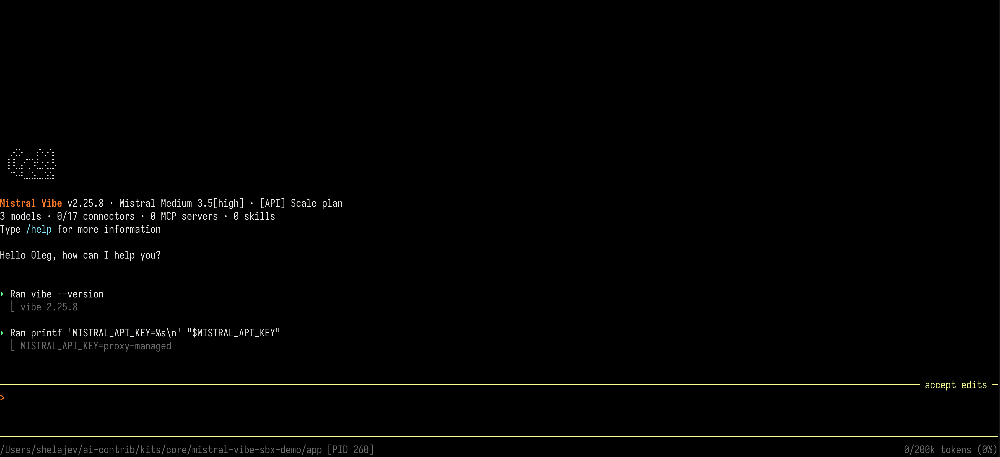
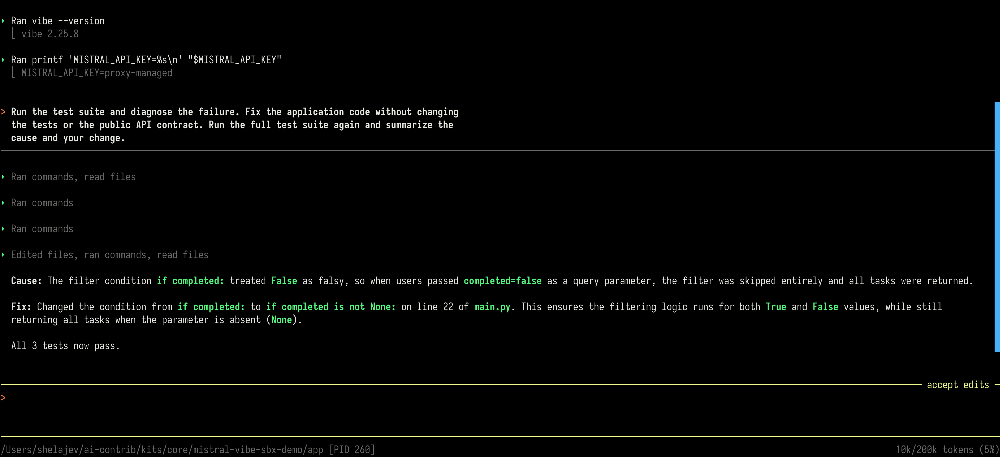
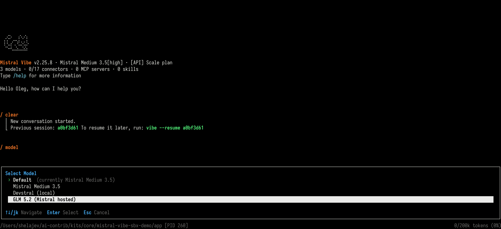

Mistral Vibe is Mistral's open source coding agent. This guide shows how to
package it as a Docker Sandbox agent so it runs in an isolated microVM instead
of directly on your host. The agent reaches Mistral through the sandbox
proxy, so your API key stays on the host.

Install a pinned Vibe version when you build the kit, then reuse that image
for each sandbox. The kit also declares the network access and credentials
Vibe needs at runtime.

In this guide, you'll learn how to:

- Store your Mistral API key on the host as a sandbox secret
- Build and publish a v3 workload kit with Vibe installed
- Launch Vibe and verify that it receives a credential placeholder
- Run a sample coding task and inspect the result

This guide uses [v3 kits](../manuals/ai/sandboxes/customize/_index.md).
Kits are Early Access, and `sbx env` is experimental.

## How isolation works

Outbound TCP traffic from the sandbox passes through a proxy on your host.
The proxy enforces network policy and injects credentials into matching
HTTP requests. Vibe sees `MISTRAL_API_KEY=proxy-managed` inside the microVM.
The real key remains in the host secret store.

Mistral is a
[built-in service](../manuals/ai/sandboxes/configuration/credentials.md#built-in-services).
The kit declares the `mistral` credential and the three hosts where Vibe
uses it: `api.mistral.ai` for inference, `console.mistral.ai` for account
lookup, and `chat.mistral.ai` for managed config. Network access and
credential injection are separate declarations. An allowed package download
doesn't receive the Mistral authorization header.

## Prerequisites

Before you start, make sure you have:

- [Docker Desktop](../get-started/get-docker.md) or Docker Engine with Buildx
- [Docker Sandboxes (`sbx`) installed and signed in](../manuals/ai/sandboxes/install.md), version 0.45.0 or later for v3 kit support
- A [Mistral API key](https://console.mistral.ai/) with an active completion allowance
- Git, for cloning the sample project
- A Docker Hub namespace, or another registry, if you want to publish your kit

The sample run uses Vibe 2.25.8 and was verified with `sbx` 0.46.0-rc5.

## Step 1: Store the Mistral key

Run this command on your host and paste the key when prompted:

```console
$ sbx secret set mistral
```

Service secrets are global by default, so sandboxes that declare the
`mistral` service can request this key. Use `--sandbox` to scope a secret to
one sandbox. The key is stored separately from the kit and workspace. See
[Credentials](../manuals/ai/sandboxes/configuration/credentials.md).

## Step 2: Install Vibe in the image

Create a kit directory beside the project you want Vibe to work on. Run the
following command from the directory that will contain both:

```console
$ mkdir mistral-vibe
```

If you don't have an existing project, create an empty workspace beside
the kit to verify the agent launch:

```console
$ mkdir my-project
```

The kit has two files with matching filename stems:

```text
mistral-vibe/
├── vibe.yaml
└── vibe.dockerfile
```

Create `mistral-vibe/vibe.dockerfile`. The `shell-docker` template supplies
the agent account, Python, `uv`, and the sandbox's Docker tooling:

```dockerfile {title="mistral-vibe/vibe.dockerfile"}
FROM docker/sandbox-templates:shell-docker

ARG VIBE_VERSION

USER agent
RUN uv tool install "mistral-vibe==${VIBE_VERSION}" \
    && uv cache clean \
    && vibe --version

ENV PATH=/home/agent/.local/bin:${PATH} \
    VIBE_ENABLE_TELEMETRY=false \
    VIBE_ENABLE_AUTO_UPDATE=false \
    GIT_TERMINAL_PROMPT=0

WORKDIR /home/agent/workspace
ENTRYPOINT ["vibe", "--trust"]
CMD []
```

The descriptor in the next step supplies `VIBE_VERSION`. Installing as
`agent` puts the executable in `/home/agent/.local/bin`. Turning off Vibe's
automatic update keeps the installed agent version fixed until you rebuild.

`--trust` lets Vibe load the mounted project's configuration without a
workspace trust prompt. Vibe still uses its tool permission prompts. Review
the project configuration before mounting it.

## Step 3: Declare access and credentials

Create `mistral-vibe/vibe.yaml`. The syntax directive selects the v3 kit
frontend, which builds the companion Dockerfile and packages the descriptor
with the image:

```yaml {title="mistral-vibe/vibe.yaml"}
# syntax=docker/sandbox-kit:3
schemaVersion: "3"
kind: workload
displayName: Mistral Vibe
description: Mistral Vibe with host-managed API credentials

args:
  version:
    default: "2.25.8"
    pattern: '^[0-9]+\.[0-9]+\.[0-9]+$'
    buildArg: VIBE_VERSION

provides: ["vibe@${{ kit.args.version }}"]

capabilities:
  - type: com.docker.sandbox/sbx@1

  - type: com.docker.sandbox/network-policy@1
    config:
      runtime:
        allow:
          - api.mistral.ai:443
          - console.mistral.ai:443
          - chat.mistral.ai:443

  - type: com.docker.sandbox/credential@1
    description: Mistral API access
    config:
      service: mistral
      phase: runtime
      apiKey:
        name: MISTRAL_API_KEY
        proxyManaged: true
        inject:
          - domain: api.mistral.ai
            header: Authorization
            format: "Bearer %s"
          - domain: console.mistral.ai
            header: Authorization
            format: "Bearer %s"
          - domain: chat.mistral.ai
            header: Authorization
            format: "Bearer %s"
```

`kind: workload` declares a kit that supplies the sandbox's root filesystem.
`args.version` selects the Vibe release, maps it to the Dockerfile build
argument, and records that version in `provides`. To install another release,
change the default and rebuild.

The `sbx@1` capability tells Docker Sandboxes to manage the agent's launch.
The image supplies its user, working directory, and entrypoint.
`network-policy@1` permits HTTPS traffic to the three Mistral hosts. Package
installation happens during the image build, so PyPI doesn't need a runtime
rule unless your coding task downloads packages.

`credential@1` gives Vibe a placeholder in `MISTRAL_API_KEY` and tells the
host proxy to write the real key into the `Authorization` header. List each
injection host explicitly in the network allowlist. The v3 validator checks
these declarations against each other; a wildcard alone doesn't cover an
injection host for validation.

## Step 4: Build and publish the kit

From the directory containing `mistral-vibe`, validate and build the kit
without publishing it:

```console
$ docker buildx build ./mistral-vibe \
    --file ./mistral-vibe/vibe.yaml \
    --output type=cacheonly
```

The build validates the descriptor and installs Vibe. Use the descriptor
with `--file`, rather than the companion Dockerfile, so the output includes
the kit metadata and capabilities.

Optional. To share the kit, sign in to your registry, replace
`YOUR_NAMESPACE` with your Docker Hub namespace, and publish for both common
architectures:

```console
$ docker login
$ docker buildx build ./mistral-vibe \
    --file ./mistral-vibe/vibe.yaml \
    --platform linux/amd64,linux/arm64 \
    --provenance=true \
    --sbom=true \
    --tag docker.io/YOUR_NAMESPACE/sbx-kit-vibe:2.25.8 \
    --push
```

This publishes the workload and its descriptor as one OCI image, with
provenance and software bill of materials attestations. You can run the
published reference in place of the local kit path in the next step.

## Step 5: Run and verify Vibe

From the same directory, launch the local kit against your project. Replace
`./my-project` with the path to the workspace Vibe should edit:

```console
$ sbx run --name mistral-vibe ./mistral-vibe ./my-project
```

`--name` gives the sandbox a predictable name for later commands. The kit
path identifies the workload; the project path identifies the directory
mounted read-write. Vibe's changes to that workspace are visible on your host.

When prompted, approve the kit's request to use your stored Mistral key.
Storing the key and approving its use are separate steps. See
[Credential bindings](../manuals/ai/sandboxes/configuration/credentials.md#credential-bindings).

At the Vibe prompt, prefix a shell command with `!` to inspect the value
available inside the sandbox:

```text
!printf 'MISTRAL_API_KEY=%s\n' "$MISTRAL_API_KEY"
```

Expected output:

```text
MISTRAL_API_KEY=proxy-managed
```

Vibe receives the placeholder while the proxy authenticates its Mistral
requests. The following capture shows this check in the sample workspace
used in the next section. Vibe displays the mounted workspace's path; your
path and account greeting will differ from the screenshots:



## Try a coding task

The community-maintained
[Mistral Vibe sample](https://github.com/shelajev/mistral-vibe-sbx-demo)
contains a small FastAPI application, three tests, and one intentional bug.
It uses the published
[Vibe kit](https://github.com/shelajev/vibe-sbx-kit), so you can try this
exercise without building or publishing your own kit. This starts a
separate sandbox from the sample's checked-in environment file. Your local
kit sandbox remains available for later use.

Type `/exit` at the Vibe prompt to return to your host terminal. Then run
these commands from a directory where you want to keep the sample:

```console
$ git clone https://github.com/shelajev/mistral-vibe-sbx-demo.git
$ cd mistral-vibe-sbx-demo
$ sbx env run
```

`sbx env run` reads the repository's `sbxenv.yaml`, pulls
`docker.io/olegselajev241/sbx-kit-vibe:2.25.8`, mounts only `app/`, and opens
Vibe in `mistral-vibe-demo-v3`. Approve the environment plan and credential
binding when prompted. Later runs attach to the same sandbox.

The environment file uses schema version 1; the kit uses schema version 3.
These formats have independent version numbers. See
[Environment files](../manuals/ai/sandboxes/configuration/environment-files.md).

Before starting the coding task, open a second host terminal and permit
Python package downloads for this sandbox:

```console
$ sbx policy allow network --sandbox mistral-vibe-demo-v3 \
    pypi.org,files.pythonhosted.org
```

The published kit permits Mistral traffic; the application needs these
additional hosts if `uv` downloads its test dependencies. The rule is scoped
to the sample sandbox, and package requests receive no Mistral credential.

Return to Vibe, which uses the project's `mistral-medium-3.5` model, and
paste this repair prompt:

```text
Run the test suite and diagnose the failure. Fix the application code without changing
the tests or the public API contract. Run the full test suite again and summarize the
cause and your change.
```

Approve the shell commands and edits when Vibe asks. The failing test checks
`GET /tasks?completed=false`: the endpoint returns all tasks instead of only
incomplete tasks. A correct repair changes `if completed:` to
`if completed is not None:`.



Check the test suite yourself at the Vibe prompt:

```text
!uv run pytest
```

The test suite should end with `3 passed`. In your second host terminal,
change to the `mistral-vibe-sbx-demo` repository and inspect the edit:

```console
$ git diff -- app/main.py
```

The repository's `.git` directory stays on the host because only `app/`
is mounted. The diff should show the filter change. To repeat the exercise,
type `/exit` in Vibe and run `git restore app/main.py` from the host
repository to restore the intentional bug.

Optional. Run `/model` inside Vibe and select **GLM 5.2 (Mistral hosted)**.
The sample adds `zai-glm-5-2` to `app/.vibe/config.toml`; the local kit you
built earlier doesn't add this model configuration.



## Troubleshoot and iterate

If Vibe can't reach a service, inspect the sandbox's proxy log from your host:

```console
$ sbx policy log mistral-vibe
```

For the sample environment, use `mistral-vibe-demo-v3` instead. If another
coding task needs additional services, add the required hosts to the
descriptor or allow them with `sbx policy allow network --sandbox`.

After editing your local descriptor or Dockerfile, return to the host
directory containing `mistral-vibe` and create another sandbox to test it.
Restarting an existing sandbox doesn't apply kit changes:

```console
$ sbx run --name mistral-vibe-test-2 ./mistral-vibe ./my-project
```

If Vibe keeps retrying without a response, inspect its log from the host:

```console
$ sbx exec mistral-vibe -- tail -n 50 /home/agent/.vibe/logs/vibe.log
```

For the sample, use `mistral-vibe-demo-v3`. Repeated `HTTP 429` responses
indicate a rate or allowance limit. Check the key's organization and workspace
at [Mistral limits](https://admin.mistral.ai/plateforme/limits). A response
with `X-Ratelimit-Limit-Req-Minute: 0` indicates zero request allowance;
the verified sample required activating pay-as-you-go. For authentication
failures, check `sbx secret ls` for a `mistral` entry and confirm the
credential binding covers all three Mistral hosts.

## Clean up

Sandboxes persist after Vibe exits. To stop the local sandbox:

```console
$ sbx stop mistral-vibe
```

To remove it:

```console
$ sbx rm mistral-vibe
```

If you created `mistral-vibe-test-2`, remove it with
`sbx rm mistral-vibe-test-2` as well. From the sample repository, remove its
environment with:

```console
$ sbx env rm --force
```

Removing a sandbox preserves the mounted workspace and its edits.

## Learn more

- [Get started with Docker Sandboxes](../manuals/ai/sandboxes/get-started.md)
- [Build an agent workload](../manuals/ai/sandboxes/customize/author/build-an-agent.md)
- [Customize sandboxes with kits](../manuals/ai/sandboxes/customize/_index.md)
- [Credentials and built-in services](../manuals/ai/sandboxes/configuration/credentials.md#built-in-services)
- [Mistral Vibe](https://github.com/mistralai/mistral-vibe)
