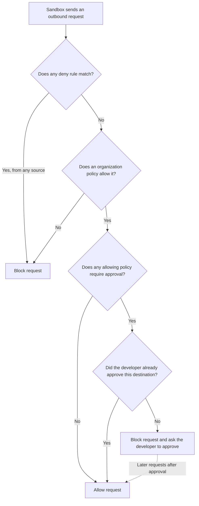



Network access policies are organization policies that control outbound
connections from sandboxes. When an organization policy is enforced for a
developer, their sandboxes can reach only the destinations your network rules
allow. Each policy contains one or more rules that allow the hosts, IP
ranges, and ports a workflow needs, or block destinations that should stay
unavailable. Rules can also match the HTTP method, path, and query parameters of
a request, so a policy can allow part of an API without allowing all of it.

Developers can also add network rules on their own machines with
[local policy](../../local/network-rules.md), but under an enforced
organization policy, only your allow rules grant access. For more details, see
[How organization policy relates to local and kit rules](_index.md#how-organization-policy-relates-to-local-and-kit-rules).

For destinations you want a person to confirm, a policy can require approval
instead of granting access outright. This page explains what a rule can match,
how approval works, example policies for common tasks, and when your changes
reach developers. To create a network
access policy, see [Create and manage organization policies](create-manage.md).

## What a network rule can match

Each rule has an optional **Rule name**, a **Type** that decides what the rule
matches, and a **Decision** of **Allow** or **Deny**. The type is either
**All traffic**, which covers whole destinations, or **HTTP**, which covers
specific requests to one destination.

### All traffic

An **All traffic** rule matches every request to its destinations, on any port,
method, and path. It has these fields:

| Field            | What it holds                                                                                                                              |
| ---------------- | ------------------------------------------------------------------------------------------------------------------------------------------ |
| **Protocols**    | **TCP**, **UDP**, or **Both**                                                                                                              |
| **Destinations** | The hosts, IP addresses, or CIDR ranges the rule covers. A destination matches any port unless it includes one, such as `example.com:8080` |

### HTTP

An **HTTP** rule matches only HTTP requests with the methods, paths, and query
parameters it lists. It has these fields:

| Field                | What it holds                                                                                                                                                                                                                                                                                                 |
| -------------------- | ------------------------------------------------------------------------------------------------------------------------------------------------------------------------------------------------------------------------------------------------------------------------------------------------------------- |
| **Destination**      | The host or IP address the rule covers, with no scheme and no path, such as `api.github.com` rather than `https://api.github.com/repos`. It matches any port unless it includes one                                                                                                                           |
| **HTTP methods**     | The methods the rule applies to. A rule needs at least one, and a rule with none fails validation. **Select all** selects every method, and **Read-only** selects `GET`, `HEAD`, and `OPTIONS`. The list doesn't include `CONNECT` or `TRACE`, unlike the CLI, where `--method ANY` matches every HTTP method |
| **Path patterns**    | One or more paths the rule covers, such as `/repos/*` and `/v1/**`. An empty field matches any path                                                                                                                                                                                                           |
| **Query parameters** | A `name=value` entry for each parameter a request must include, such as `ref=Release*`. Entries are separated by Enter or `&`. A request matches only if it includes every entry, and the entries apply to every path pattern in the rule. An empty field matches any query string                            |

An HTTP rule's paths all belong to its one destination, so paths on another
host need a second rule. For the pattern and query parameter syntax and
how HTTP rules combine with **All traffic** rules, see
[HTTP rules](../../reference/network-rules.md#http-rules).

## Approval-required access

A network access policy can require approval instead of granting access
outright. Destinations the policy allows aren't reachable until the developer
confirms them, which keeps an allowlist broad enough to be usable while still
putting a person in front of each destination an agent reaches for. To turn
it on when you create or edit a policy, see
[Create and manage organization policies](create-manage.md).

In an organization policy, approval is a property of the policy rather than of
individual rules, so turning it on applies it to every allow rule in that
policy. A destination stays directly reachable only when no policy that
allows it requires approval. If a policy that requires approval also matches,
the request needs approval regardless of what the other policies allow.

A request is handled as follows:

Only a destination the developer has already approved satisfies the requirement.
Preset rules, kit rules, and rules the developer added with `sbx policy
allow network` don't answer it. An approval also can't reach a destination the
organization doesn't allow at all, and it can't override a deny rule. To
withdraw a destination, add a deny rule, which takes precedence over any
approval already recorded.

Developers respond to approval requests from the command line. For what they
see and how they respond, see
[Respond to approval requests](../../local/approvals.md).

## Example policies

The following policies show common ways to allow and block network access.
Adapt the destinations and paths to the services your developers use.

### Allow package registries

To let developers install npm and Python packages, create an **All traffic**
allow rule with these fields:

| Field            | Value                                                      |
| ---------------- | ---------------------------------------------------------- |
| **Protocols**    | **TCP**                                                    |
| **Destinations** | `registry.npmjs.org`, `pypi.org`, `files.pythonhosted.org` |

Sandboxes can reach these hosts on any port, with any method and path.

### Allow read-only access to an API

To let agents read repository data from the GitHub API without changing it,
create an **HTTP** allow rule with these fields:

| Field             | Value                                                     |
| ----------------- | --------------------------------------------------------- |
| **Destination**   | `api.github.com`                                          |
| **HTTP methods**  | **Read-only**, which selects `GET`, `HEAD`, and `OPTIONS` |
| **Path patterns** | `/repos/**`                                               |

Because no **All traffic** rule covers `api.github.com`, this rule is the only
access to it. Reads under `/repos` are allowed. Other methods, such as `POST`,
and other paths are denied.

### Block one endpoint on an allowed host

To allow an API but keep agents away from its admin endpoints, create two
rules. An **All traffic** allow rule covers the host:

| Field            | Value             |
| ---------------- | ----------------- |
| **Protocols**    | **TCP**           |
| **Destinations** | `api.example.com` |

An **HTTP** deny rule narrows it:

| Field             | Value             |
| ----------------- | ----------------- |
| **Destination**   | `api.example.com` |
| **HTTP methods**  | `POST`            |
| **Path patterns** | `/v1/admin/**`    |

`POST` requests under `/v1/admin` are blocked. Every other request to
`api.example.com` is allowed. For how the two kinds of rule combine, see
[How HTTP and host rules combine](../../reference/network-rules.md#how-http-and-host-rules-combine).

## When changes take effect

Once a policy change has
[synced to the developer's machine](_index.md#when-policy-changes-reach-developers),
it applies to new connections. Connections already established stay open until
the sandbox restarts.

An approval requirement applies from the point the policy change syncs.
Destinations a developer already approved stay reachable, because the approval
is recorded on the developer's machine.
