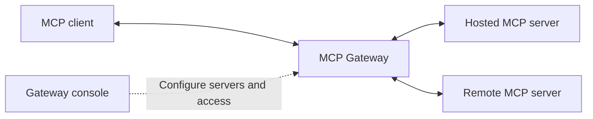

Docker MCP Gateway connects AI applications to tools from multiple Model Context
Protocol (MCP) servers through one endpoint. Use it to provide a selection of
servers to a team, connect service accounts, and manage servers and access from
a console.

An MCP client is the application where you work with AI. An MCP server provides
tools, such as searching documentation or updating an issue. A gateway groups a
selection of servers behind an endpoint that you add to your client.

## How it works

Use the gateway console to choose servers and connect any accounts they need.
Then add the gateway endpoint to your MCP client. Your client discovers the
servers' tools and sends tool calls through the gateway.

Servers can run as containers managed by the gateway service or as remote
endpoints hosted elsewhere. With gateway-managed authentication, the gateway
holds your service credentials and uses them when calling a server. Those
credentials aren't stored in your MCP client.

You can use a gateway provided by your administrator, or create one with your
own selection of servers if you have permission. A server listed in the console
isn't automatically included in every gateway. Sharing a gateway also doesn't
sign other people into its upstream services.

## Get access

MCP Gateway can be Docker-hosted or self-hosted. To discuss access for your
organization, <a href="https://www.docker.com/pricing/contact-sales/"
id="dkr_docs_cs_mcp_gateway" class="link" rel="noopener">contact Docker Sales</a>.

If your organization already has a deployment, ask your administrator for the
console URL and access. These guides cover using that console. Available
actions depend on your permissions and your deployment's configuration.

Installing and operating a self-hosted deployment are outside the scope of
these guides. You don't need to deploy the service to connect a client to a
gateway that your administrator provides.

## Choose a task

| If you want to | Start here |
| --- | --- |
| Use MCP tools from your AI application | [Connect and use MCP tools](connect-client.md) |
| Choose a set of servers for yourself or a team | [Create and share a gateway](create-gateway.md) |
| Make an existing MCP server available to others | [Publish an MCP server](publish-server.md) |
| Set up team access and understand security boundaries | [Manage access and security](manage-access.md) |

The console's user guide includes detailed field descriptions and additional
management procedures.

## Use MCP through other Docker products

[Docker Agentic Platform](/manuals/agentic-platform/mcp.md) provides a gateway
endpoint for your user in the selected account. In DAP, you connect servers,
authorize accounts, and add that endpoint to a client. Use the gateway console
for the server publishing, gateway creation, and role management procedures in
this section.

For registration, authentication, and loading servers through the `sbx` CLI, see
[Docker Sandboxes MCP gateway](/manuals/ai/sandboxes/mcp-gateway.md).
Sandboxes supports local and hosted gateway backends. Its CLI workflows differ
from the gateway console procedures in this section.
