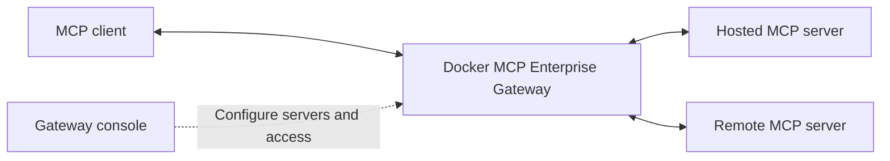

Docker MCP Enterprise Gateway connects AI applications to tools from multiple
Model Context Protocol (MCP) servers through one endpoint. It gives your
organization a central place to manage which servers and tools agents can use,
authenticate users, supply service credentials, and apply governance policies.
Use the self-service console or API to manage your catalog of MCP servers,
create shared gateways, and delegate access to teams.

An MCP client is the application where you work with AI. An MCP server provides
tools, such as searching documentation or updating an issue. A gateway groups a
selection of servers behind an endpoint that you add to your client.

## How it works

Use the gateway console to choose servers and connect any accounts they need.
Then add the gateway endpoint to your MCP client. Your client discovers the
servers' tools and sends tool calls through the gateway.

Servers can run as containers managed by the gateway service or as remote
endpoints hosted elsewhere. With gateway-managed authentication, the gateway
holds your service credentials and uses them when calling a server. Those
credentials aren't stored in your MCP client.

You can use a gateway provided by your administrator, or create one with your
own selection of servers if you have permission. A server listed in the console
isn't automatically included in every gateway. Sharing a gateway also doesn't
sign other people into its upstream services.

## Deployment options

Docker MCP Enterprise Gateway is available as a Kubernetes appliance that you
can deploy on your own cluster. This includes private, air-gapped environments
where catalogs, server images, and policies load from inside your network.
Docker also offers a Docker-operated deployment inside your cloud account or
virtual private cloud (VPC), keeping data and traffic in your environment.

Your deployment administrator configures the gateway to connect to your
identity provider, credential stores, telemetry destinations, and policy
services. Installing and operating a deployment are outside the scope of
these guides. You don't need to deploy the service to connect a client to a
gateway that your administrator provides.

## Identity and access

Connect the gateway to your organization's identity provider (IdP) to
authenticate users. Supported providers include Okta, Microsoft Entra ID,
Auth0, and Keycloak. Map IdP groups to roles so teams can manage their own
servers and gateways without maintaining a separate set of users.

Resource permissions and ownership control who can view, change, delete, or
share servers, gateways, and secrets. Administrators can delegate creation
permissions to teams and block a server across every gateway that uses it.
For details, see
[Manage access and security](manage-access.md).

## Server catalog and secrets

Use the self-service console to publish and manage a catalog of MCP servers,
including internal servers. A server can run as a container managed by the
gateway service or as a remote endpoint. Teams can create gateways that expose
the servers they need through a shared endpoint.

Manage API keys, OAuth client secrets, and other credentials separately from
server configuration. Servers reference secrets by name, and permissions
control who can read or update their values. For gateway-managed
authentication, the gateway supplies credentials when calling the upstream
service, keeping those credentials out of MCP client configuration files.
Sharing a gateway doesn't share personal service accounts.

See [Publish an MCP server](publish-server.md) to configure a server and its
credentials, or [Create and share a gateway](create-gateway.md) to make a
selection of servers available to a team.

## Governance and observability

Integrate with Docker AI Governance to enforce your Docker organization's
MCP policies on requests through the gateway and send audit records to your
security information and event management (SIEM) system. Administrators
configure the integration in **Platform settings**. Policy enforcement and
audit delivery require setup for your organization and deployment. See
[Governance integration](manage-access.md#governance-integration).

The gateway also integrates with your telemetry infrastructure. Configure
OpenTelemetry exports to send operational events and metrics, such as tool
call counts, latency, and error rates, to your monitoring and logging
backends. Telemetry export is configured per deployment and must be enabled
by your deployment administrator.

## API access

The management API supports automation from scripts and CI pipelines. Use it
to manage gateways, servers, secrets, roles, permissions, and platform
settings. In deployments with permissions enabled, the API accepts access
tokens from your IdP and applies the caller's permissions.

For authentication requirements, request formats, and available operations,
use the API reference in your deployment's console.

## Get access

To discuss Docker MCP Enterprise Gateway access and deployment options for
your organization, <a href="https://www.docker.com/pricing/contact-sales/"
id="dkr_docs_cs_mcp_gateway" class="link" rel="noopener">contact Docker Sales</a>.
You can also explore the
[Docker MCP Enterprise Gateway product page](https://www.docker.com/products/mcp-enterprise-gateway/).

If your organization already has a deployment, ask your administrator for the
console URL and access. These guides cover using that console. Available
actions depend on your permissions and your deployment's configuration.

## Choose a task

| If you want to | Start here |
| --- | --- |
| Use MCP tools from your AI application | [Connect and use MCP tools](connect-client.md) |
| Choose a set of servers for yourself or a team | [Create and share a gateway](create-gateway.md) |
| Make an existing MCP server available to others | [Publish an MCP server](publish-server.md) |
| Set up team access and understand security boundaries | [Manage access and security](manage-access.md) |

The console's user guide includes detailed field descriptions and additional
management procedures.

## Use MCP through other Docker products

[Docker Agentic Platform](/manuals/agentic-platform/mcp.md) provides a gateway
endpoint for your user in the selected account. In DAP, you connect servers,
authorize accounts, and add that endpoint to a client. Use the gateway console
for the server publishing, gateway creation, and role management procedures in
this section.

For registration, authentication, and loading servers through the `sbx` CLI, see
[Docker Sandboxes MCP gateway](/manuals/ai/sandboxes/mcp-gateway.md).
Sandboxes supports local and hosted gateway backends. Its CLI workflows differ
from the gateway console procedures in this section.
