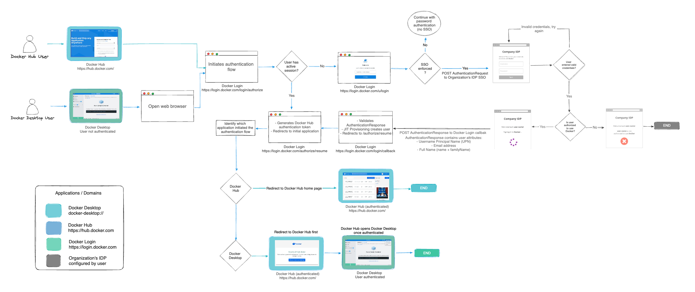



Single sign-on (SSO) lets users access Docker by authenticating through their
identity providers (IdPs). You can configure SSO for an entire company,
including all associated organizations, or for a single organization that has
a Docker Business subscription.

## How SSO works

When SSO is enabled, Docker supports a non-IdP-initiated flow for user
sign-in. Instead of signing in with a Docker username and password, users are
redirected to your IdP's sign-in page. Users must start SSO authentication by
signing in to Docker Hub or Docker Desktop.

The following diagram shows how SSO operates between Docker Hub, Docker
Desktop, and your IdP.

## Set up SSO

To configure SSO in Docker, follow the procedure in
[Configure single sign-on](connect.md):

1. [Add a domain](connect.md#step-1-add-a-domain).
1. [Verify your domain](connect.md#step-2-verify-your-domain).
1. [Create an SSO connection in Docker](connect.md#step-3-create-an-sso-connection-in-docker).
1. [Create an SSO connection in your IdP](connect.md#step-4-create-an-sso-connection-in-your-idp).
1. [Connect Docker to your IdP](connect.md#step-5-connect-docker-to-your-idp).
1. [Test the connection](connect.md#step-6-test-the-connection).

After the connection works,
[provision users](/manuals/security/provisioning/_index.md), optionally
[enforce SSO](connect.md#enforce-sso) or
[enforce sign-in](/manuals/desktop/enterprise/enforce-sign-in/_index.md) on
Docker Desktop, and [manage your SSO configuration](manage.md).

Once configuration is complete, users can sign in to Docker services using
their company email address. After signing in, users are added to your
company, assigned to an organization, and added to a team.

> [!IMPORTANT]
>
> When SSO is enforced, CLI password-based sign-in is no longer supported. Use
> a personal access token (PAT) for CLI access. For more information, see the
> [security announcement](/manuals/security/security-announcements.md#deprecation-of-password-logins-on-cli-when-sso-enforced).

## Next steps

- Start [configuring SSO](connect.md).
- Read the [FAQs](/manuals/faqs/security.md).
- [Troubleshoot](/manuals/security/authentication/single-sign-on/troubleshoot-sso.md)
  SSO issues.
